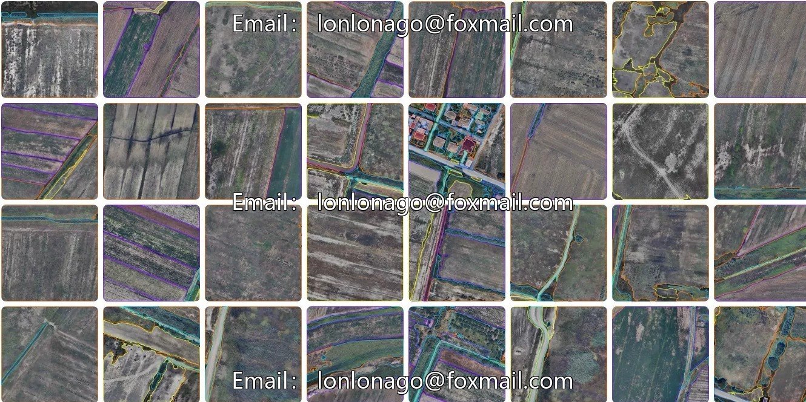
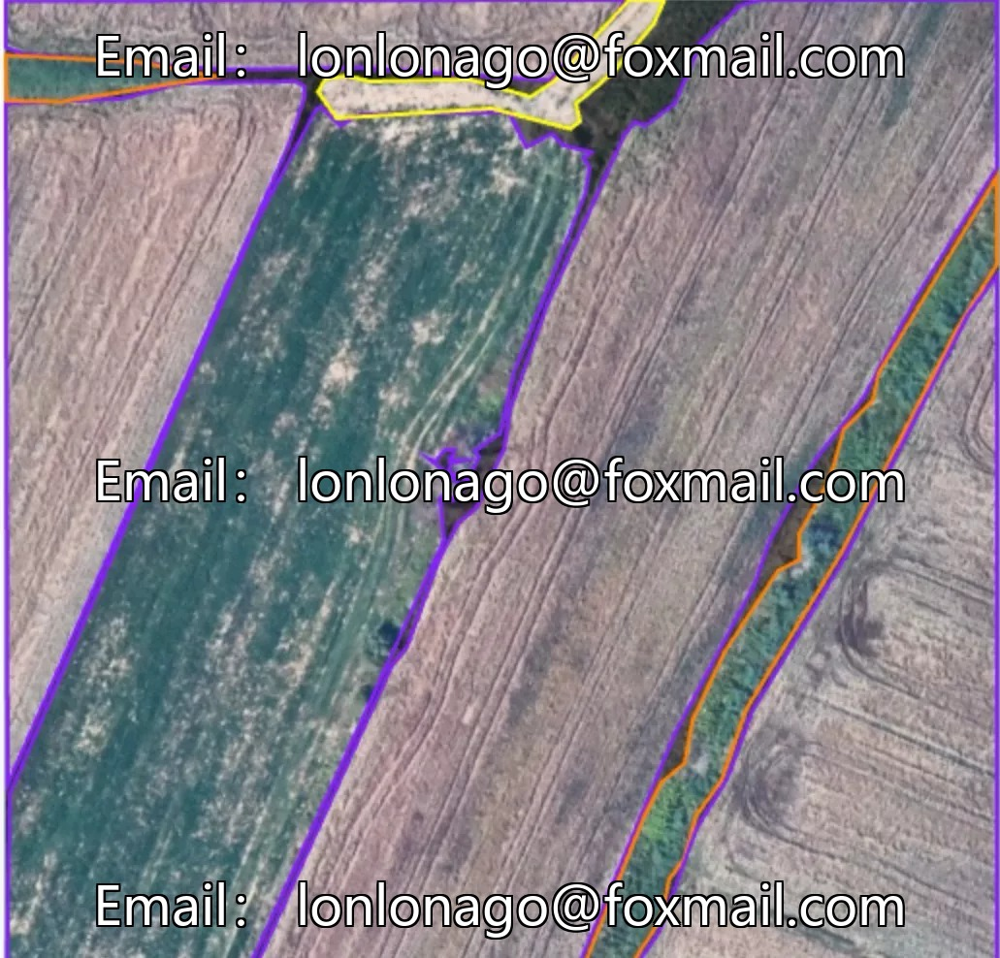
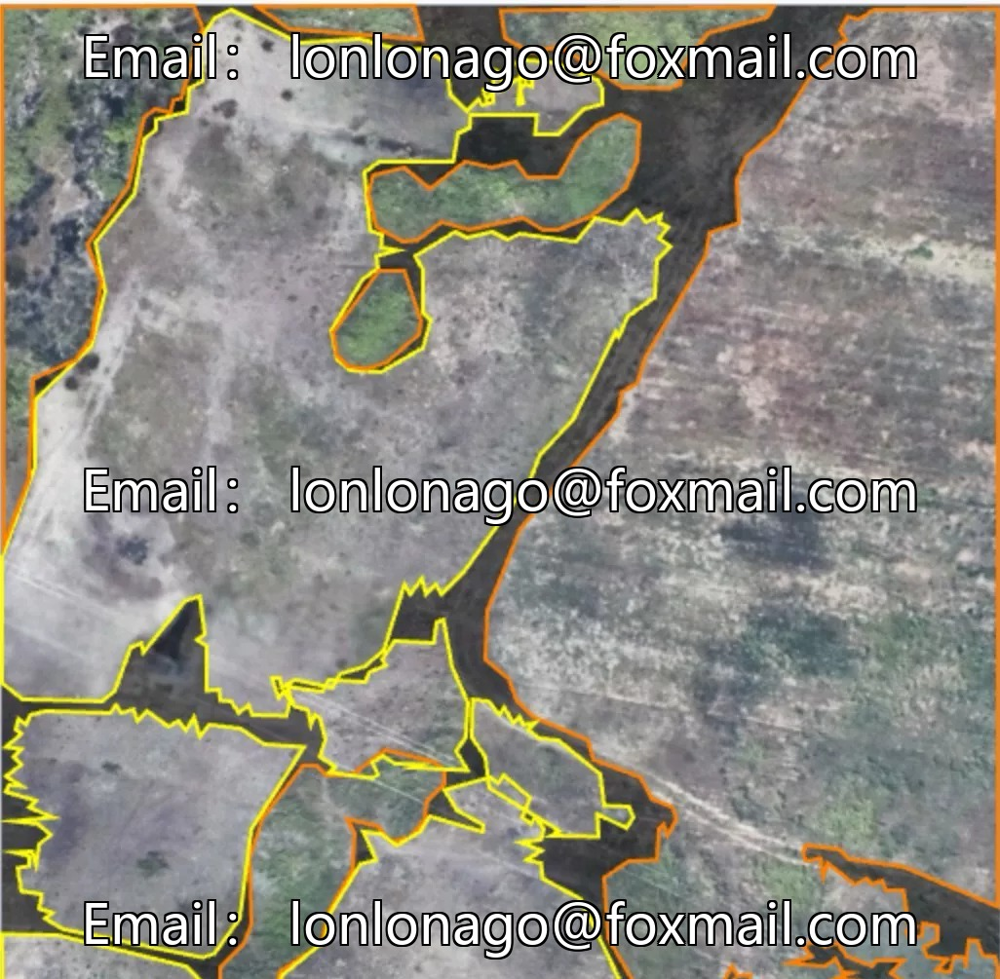
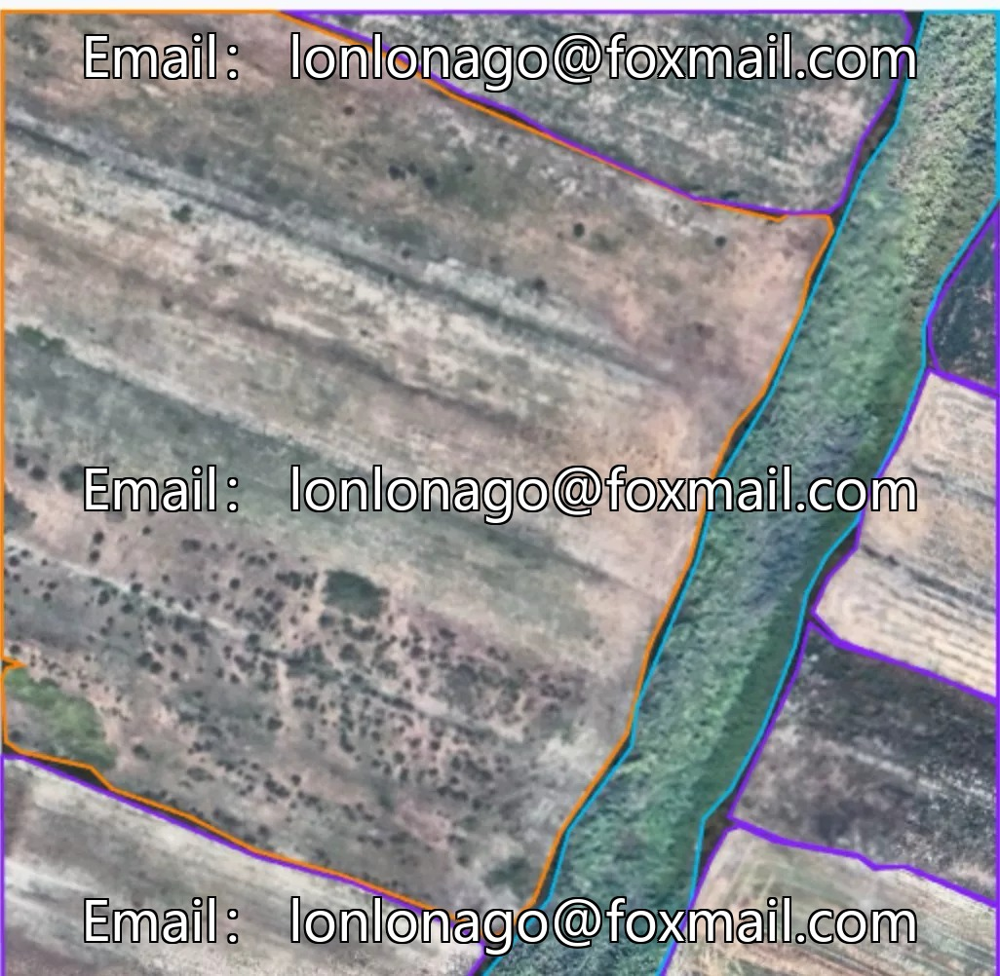
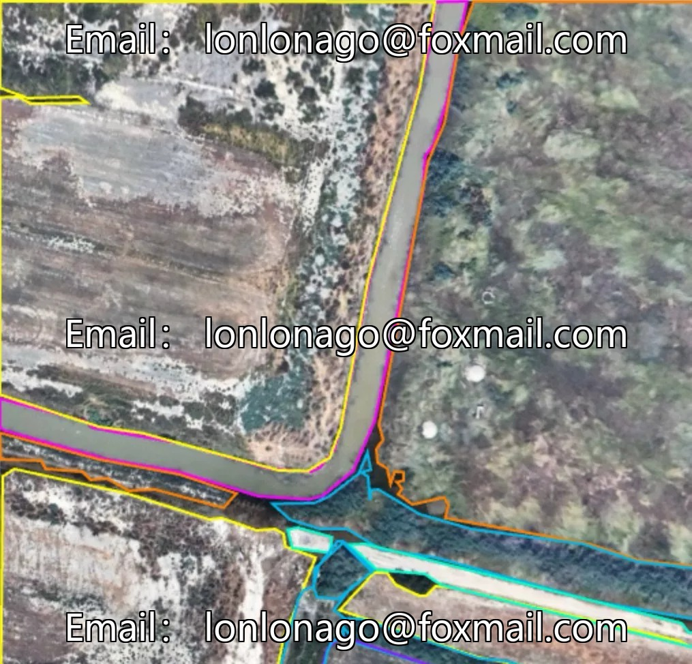
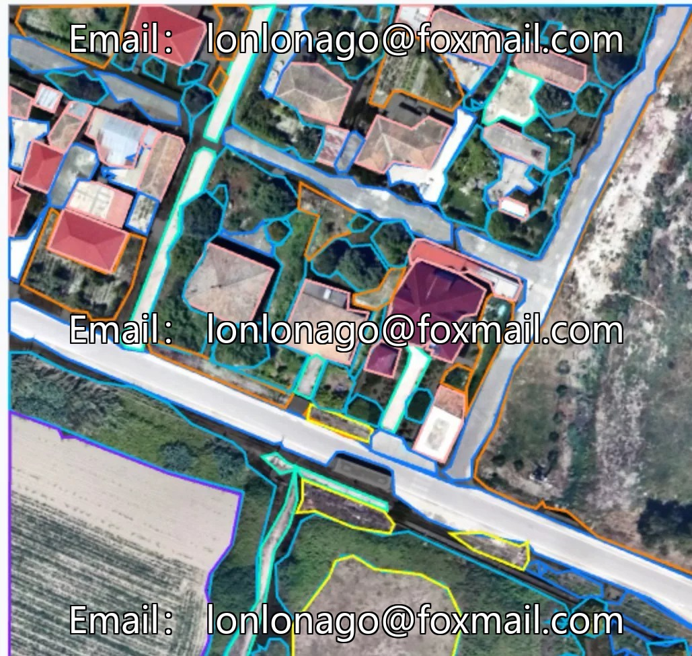

# Drone aerial photography inspection dataset, remote sensing cultivated land segmentation dataset, mountain and river channel segmentation recognition

## Body

Drone aerial photography inspection dataset, remote sensing cultivated land segmentation dataset, mountain and river channel segmentation recognition, environmental protection environment monitoring dataset, agricultural resource survey dataset, image segmentation dataset 10205 issue

Contains 220 aerial images of drones, categorized into 9 categories: bare soil (bare), building (building), farmland (farm), greenhouse (greenhouse), herbaceous (herb), impervious (impervious), pervious (pervious), vegetation (vegetation), water. Suitable for semantic segmentation tasks, supports training of computer vision models.

The dataset format is primarily image files, and the annotation format supports the needs of semantic segmentation. It is suitable for scenes such as land surface cover classification, environmental monitoring, agricultural resource surveys, etc.

Virtual materials, once sold, are non-refundable.
Interested friends, click "I want" to proceed.

## Images

## Payment

Here is a pay link on Stripe ( https://buy.stripe.com/3cs8yP7sY87d0vu9AB ). Please contact me lonlonago@foxmail.com after funding $89, and I will send you a complete data files , thank you!

